# Library Management System

<p align="center">
  A Full-Stack Web Application built with Java, Spring Boot, React and MySQL.
</p>

<p align="center">
  
  
  
  
  
</p>

## Overview

The **Library Management System** is a full-stack web application developed to simplify and manage library operations.

It provides functionality for managing books, members, borrowing transactions, returns, overdue books and fines through a user-friendly interface.

The application uses Spring Boot to build secure REST APIs, React for the frontend and MySQL for database management. It also implements JWT authentication and role-based authorization for Admin and User accounts.

## Application Screenshots

### Admin Dashboard

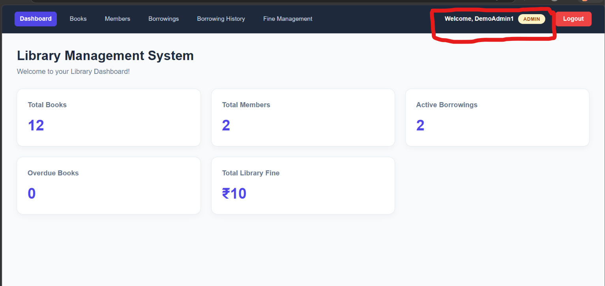

### User Login

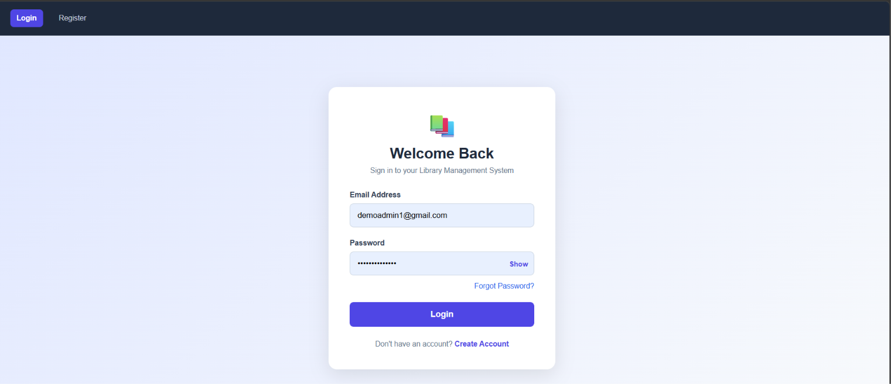

### User Registration

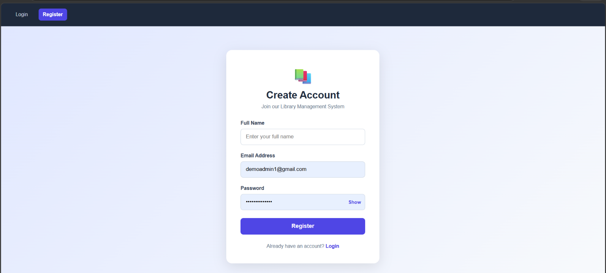

### Book Management

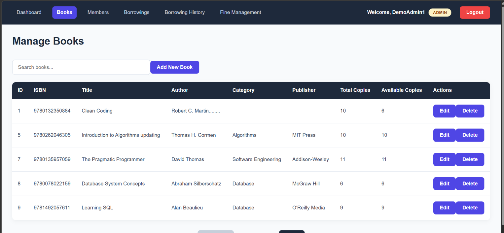

### Member Management

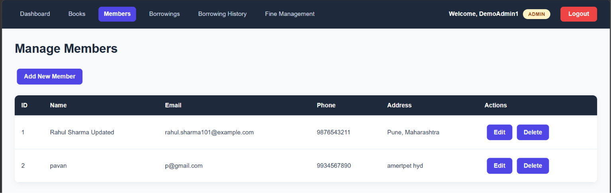

### User Records

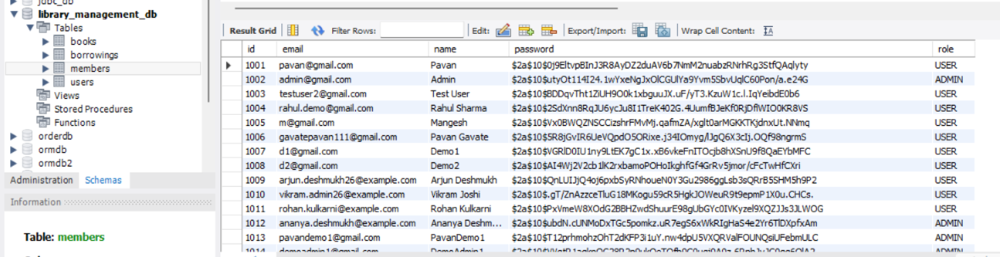

### Active Borrowings

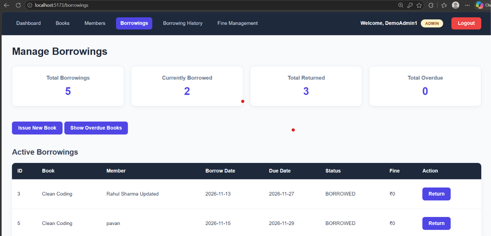

### Borrowing History

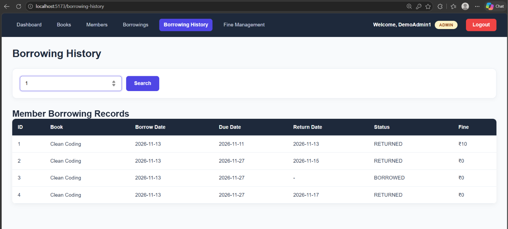

### Fine Management

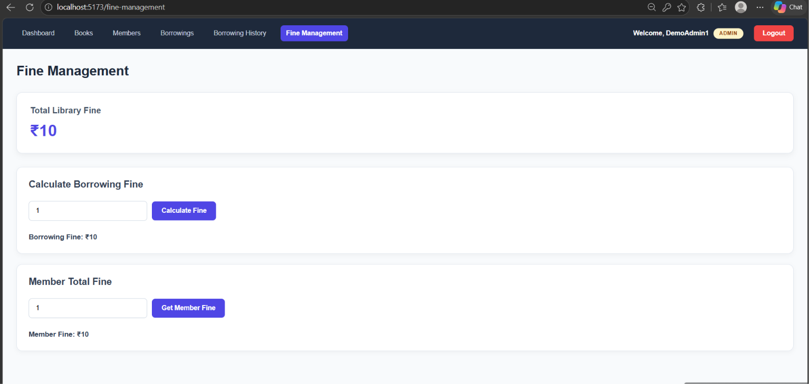

### Database - Books

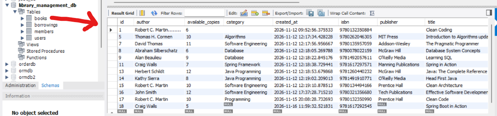

### Database - Borrowings

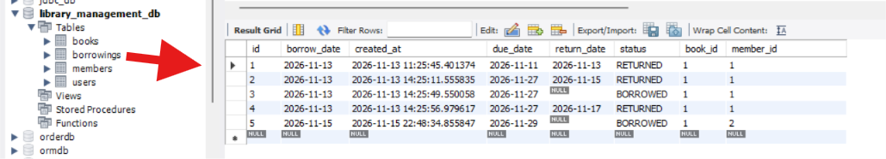

## Key Features

### 1. Authentication and Security

- User registration and login.
- JWT-based authentication.
- Spring Security integration.
- Role-based authorization (ADMIN and USER).
- Password encryption using BCrypt.
- Forgot password functionality.
- Email-based password reset using Gmail SMTP.
- Protected REST API endpoints.

### 2. Book Management

- Add new books.
- View all books.
- Update book information.
- Delete books.
- Search books.
- View available books.
- Pagination and sorting.
- Book category statistics.
- Prevent deletion of books with existing borrowing history.

### 3. Member Management

- Add new members.
- View member details.
- Update member information.
- Delete members.
- Search and manage member records.
- Prevent deletion of members with existing borrowing history.

### 4. Borrowing Management

- Issue books to members.
- Return borrowed books.
- View active borrowings.
- View borrowing history.
- Track borrowing dates and due dates.
- Identify overdue books.
- Calculate fines.
- Maintain borrowing records.

### 5. Fine Management

- Track overdue books.
- Calculate applicable fines.
- View fine information.

### 6. Additional Features

- Dashboard and library statistics.
- RESTful API development.
- Swagger API documentation.
- Centralized exception handling.
- Input validation.
- Scheduled overdue-book processing.

## Technology Stack

### Backend Technologies

| Technology | Purpose |
|---|---|
| Java 21 | Core programming language |
| Spring Boot | Backend application development |
| Spring MVC | REST API development |
| Spring Security | Application security |
| Spring Data JPA | Database operations |
| Hibernate ORM | Object-relational mapping |
| JWT | Authentication |
| BCrypt | Password encryption |
| Jakarta Bean Validation | Input validation |
| Maven | Dependency and build management |

### Frontend Technologies

| Technology | Purpose |
|---|---|
| React | User interface development |
| JavaScript | Frontend programming |
| HTML5 | Page structure |
| CSS3 | Styling |
| Axios | HTTP communication |
| React Router DOM | Frontend routing |
| Vite | Frontend development and build tool |

### Database

- MySQL

### Email Integration

- JavaMailSender
- Gmail SMTP
- Email-based password reset

### Development and Testing Tools

- IntelliJ IDEA
- Git
- GitHub
- Postman
- Swagger UI
- Maven
- npm

## Application Architecture

The application follows a layered backend architecture with a separate React frontend.

```text
                 React Frontend
                       |
                       |
                Axios HTTP Requests
                       |
                       v
             Spring Boot REST APIs
                       |
                       v
                 Controller Layer
                       |
                       v
                  Service Layer
                       |
                       v
                Repository Layer
                       |
                       v
                 MySQL Database
```

Spring Security and JWT are used to protect backend API endpoints.

## Backend Project Structure

```text
src/main/java/com/library/lms/
│
├── config/
│   ├── OpenApiConfig.java
│   ├── OverdueScheduler.java
│   ├── PasswordConfig.java
│   └── SecurityConfig.java
│
├── controller/
│   ├── AuthController.java
│   ├── BookController.java
│   ├── BorrowingController.java
│   └── MemberController.java
│
├── dto/
├── entity/
├── exception/
├── mapper/
├── repository/
├── security/
│
└── service/
    └── impl/
```

## Frontend Project Structure

```text
frontend/src/
│
├── assets/
├── components/
├── context/
├── pages/
│
├── services/
│   ├── api.js
│   ├── authService.js
│   ├── bookService.js
│   ├── borrowingService.js
│   └── memberService.js
│
├── App.jsx
├── App.css
├── index.css
└── main.jsx
```

## Database Design

**Database Name:** `library_management_db`

The main entities used in the application are:

- User
- Book
- Member
- Borrowing

Spring Data JPA and Hibernate are used for database persistence and entity relationships.

## Installation and Setup

### Prerequisites

Install the following software:

- JDK 21
- Node.js and npm
- MySQL Server
- IntelliJ IDEA
- Git

### 1. Clone the Repository

```bash
git clone https://github.com/pavangavate111/library-management-system.git
cd library-management-system
```

### 2. Configure MySQL Database

Create the database in MySQL:

```sql
CREATE DATABASE library_management_db;
```

Configure the database connection in:

`src/main/resources/application.properties`

Set your own MySQL username and password.

### 3. Configure Email Properties

For the password reset functionality, configure the following environment variables:

```text
MAIL_USERNAME
MAIL_PASSWORD
```

Also configure the frontend URL used to generate password-reset links.

**Security Note:** Never upload database passwords, Gmail App Passwords, JWT secrets or other sensitive credentials to GitHub.

### 4. Run the Spring Boot Backend

Open a terminal in the main project directory.

For Windows:

```powershell
.\mvnw.cmd spring-boot:run
```

Backend URL:

http://localhost:8080

### 5. Run the React Frontend

Open another terminal:

```bash
cd frontend
npm install
npm run dev
```

Open the local URL displayed by Vite in your browser.

## API Documentation

The project uses Swagger UI for API documentation and testing.

Swagger URL:

http://localhost:8080/swagger-ui/index.html

You can also test REST API endpoints using Postman.

## Testing and Build Verification

The application was manually tested to verify its major functionalities.

Testing included:

- User registration and login.
- JWT authentication.
- Admin and User access.
- Book CRUD operations.
- Member CRUD operations.
- Book issue and return.
- Borrowing history.
- Fine management.
- Forgot password and password reset.
- REST API testing using Postman and Swagger UI.

### Backend Build Verification

Command:

```powershell
.\mvnw.cmd clean package -DskipTests
```

### Frontend Build Verification

Command:

```bash
npm run build
```

Both backend packaging and frontend production builds completed successfully.

## Future Improvements

- Cloud deployment.
- Automated test coverage.
- Additional reporting and analytics.

## Developer

**Pavan Gavate**

Java Backend Developer | Full-Stack Developer

- GitHub: [github.com/pavangavate111](https://github.com/pavangavate111)
- LinkedIn: [linkedin.com/in/pavan-a-gavate](https://linkedin.com/in/pavan-a-gavate)
- LeetCode: [leetcode.com/u/pavanleetcode111](https://leetcode.com/u/pavanleetcode111)

---

<p align="center">
  <b>Library Management System</b><br/>
  Full-Stack Web Application<br/>
  Java 21 | Spring Boot | React | MySQL
</p>